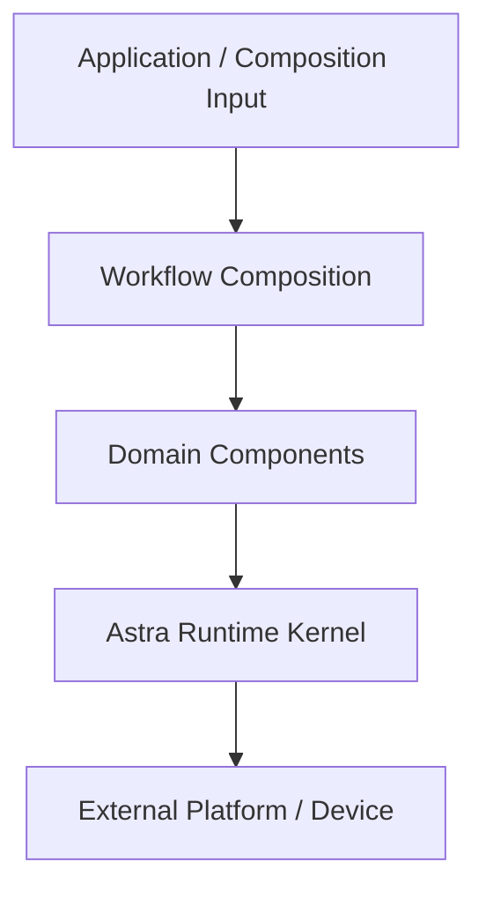
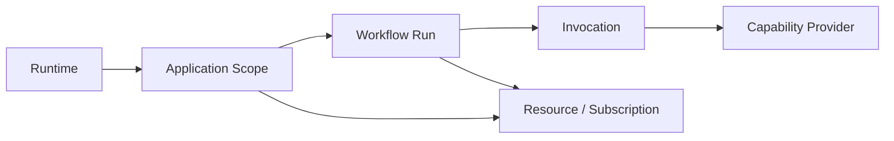

# Astra 底座设计基线

**状态**：已决定的设计基线，待实现验证  
**版本**：Base Design 0.3
**日期**：2026-11-05
**范围**：单进程、本地 Python Runtime 的概念设计，不冻结具体代码 API

本文把愿景和边界收敛成一套可以进入 RFC 和验收设计的底座模型。它描述责任、关系和不变量，不规定类名、目录结构或序列化格式。

## 1. 设计目标

Astra 底座要解决的是“如何安全地组合和运行能力”，而不是“如何实现某一种智能产品”。第一阶段完成后，开发者应能够：

- 装载多个独立 Component；
- 通过 Capability 找到并调用提供者；
- 用 Workflow 组织多个调用、流和分支；
- 让 Workflow 自身成为可调用的 Component；
- 追踪一次执行的父子关系、终态、取消和资源清理；
- 在权限拒绝、能力缺失、Provider 歧义和迟到结果时安全失败。

第一阶段只追求一个独立、最小、可验证的 Runtime。外部项目的模块接入、自动包装和兼容策略属于后续适配层，不构成底座的前置依赖。

## 1.1 插件、组件与工作流

Plugin 是组件和工作流的发现、分发与离线载入单位。它不是新的运行时调用原语。

一个 Plugin 可以包含：

- 一个或多个 Component；
- 一个或多个 Capability；
- 一个或多个 Workflow；
- 依赖、配置和权限声明。

Component 是 Runtime 的装载和生命周期单位。Workflow 在运行时可以作为 Workflow Component，对外提供 Capability。Workflow Package 可以作为 Plugin 被载入，但 Runtime 最终仍然通过 Component 和 Capability 工作。

```text
Plugin Package
    → Component / Workflow Component
    → Capability Registry
    → Workflow Composition
```

插件管理、组件注册和消息流程执行是三个相互连接但职责不同的层次。插件的安装、发现和启停不能直接决定某条消息的业务流程。

## 2. 分层模型



### Kernel 层

Kernel 提供注册、解析、调用、Scope、生命周期、取消、资源所有权、权限执行边界和基础诊断。它只理解通用执行语义。

### Component 层

Component 提供一个或多个 Capability，声明依赖和资源，接受 Runtime 的启停管理。Component 内部可以保留完整的领域对象和算法。

### Workflow 层

Workflow 负责选择能力、组织顺序、传递数据、处理分支和决定业务失败策略。它可以被装载成 Workflow Component，对外暴露一个或多个 Capability。

### Application 层

Application 或外置组合输入选择 Component、建立 Capability Binding，并决定哪些 Workflow 参与运行。不同组合可以共用同一个 Runtime。可管理的 Profile、配置编辑器和用户级配置不属于第一阶段。

## 3. 核心对象关系



### Runtime

Runtime 是进程内的运行时容器，负责 Component 管理、Capability Registry、Resolver、Scope 管理、Invocation 执行、EventBus 和诊断。

### Scope

Scope 是资源、订阅、权限可见性和取消传播的边界。它不是全局上下文，也不是某一种领域会话的替代品。

当前允许的语义层级是：

```text
Runtime
  └─ Application Scope
       └─ Workflow Run Scope
            └─ Invocation Context
```

Session、Interaction 等领域作用域可以由 Application 自行增加，不是 Kernel 必需层级。

### Run

Run 表示一次工作流或后台执行，拥有 `run_id`、父级关系、状态、取消信号和资源集合。Run 不等于消息、Turn 或 Task；这些是领域身份。

### Invocation

Invocation 表示一次明确的 Capability 调用，拥有 `invocation_id`、父级 Invocation、绑定的 Provider、请求截止时间和终态。

### Provider Binding

一次 Workflow Run 开始后，应固定它使用的 Workflow Definition、Composition Generation 和能力绑定策略。一次 Invocation 开始后，应固定其 Provider Binding。运行期间的 Provider 替换不改变已经开始的调用；新的调用也不能越过当前 Run 的 Generation 使用新的组合。

插件更新、Provider 替换或 Workflow 修改会产生新的 Composition Generation。它只是 Runtime 内部的不可变执行代际，不是需要用户管理的 Profile 子系统。新 Generation 只服务新的 Run，旧 Generation 进入排空状态，等待现有 Run 结束后再停止和释放。

## 4. 身份与所有权

Kernel 维护通用因果身份：

- `run_id`：一次执行；
- `invocation_id`：一次能力调用；
- `parent_id`：父 Invocation 或父 Run；
- `correlation_id`：跨执行关联同一业务触发。

领域组件可以维护自己的 `turn_id`、`message_id`、`task_id`、`segment_id` 或 `motion_run_id`。Kernel 不解释这些领域身份。

状态必须具有单一写入 Owner：

| 状态 | Owner |
|---|---|
| Component 启停 | Runtime / Component 生命周期管理器 |
| Provider Binding | Resolver / Invocation |
| Run 和 Invocation 终态 | 对应执行管理器 |
| 订阅和后台任务 | 创建它们的 Scope |
| 外部业务状态 | 领域 Component |
| 领域业务状态 | 领域 Component 或外部领域 Runtime |

## 5. Capability 契约

Capability 是稳定契约，至少包含以下语义字段：

| 字段 | 设计要求 |
|---|---|
| Identity | 命名空间、名称和契约版本明确 |
| Input / Output | 输入和输出类型可说明、可验证 |
| Mode | Invoke、Stream 或两者 |
| Terminal States | 成功、失败、取消、超时等终态明确 |
| Cancellation | 是否支持取消，取消由谁发起，终止如何确认 |
| Deadline | 是否支持截止时间以及超时后的资源收束 |
| Backpressure | Stream 是否有界，生产者如何感知消费压力 |
| Side Effect | 纯计算、本地资源、外部副作用等类别 |
| Permission | 调用前需要的授权条件 |

Capability 的存在、是否授权给 Agent、以及是否转换成模型 Tool Schema，属于三个不同决策层。

### Resolution 规则

Resolver 在当前 Scope 中按以下顺序工作：

1. 检查调用方声明的 Capability Identity 和版本约束；
2. 过滤当前 Scope 可见且已启动的 Provider；
3. 应用显式 Binding 或策略；
4. 得到唯一 Provider 后创建 Invocation Binding；
5. 无 Provider、版本不兼容或存在无法消解的歧义时确定性失败。

第一阶段不允许静默选择一个不明确的 Provider。

## 6. 执行语义

一次调用的抽象过程是：

```text
Resolve
  → Authorize
  → Create Invocation
  → Execute
  → Observe Result / Stream
  → Finalize
  → Release Invocation Resources
```

授权失败必须发生在 Provider 执行之前。`Finalize` 只负责记录 Kernel 终态，不能伪造领域完成事实。

Kernel 终态与领域终态分离。例如，工具调用完成不代表消息发送完成，消息发送完成不代表音频播放完成。

## 7. Run、Invocation 与取消

默认父子关系如下：

- Workflow 创建的 Invocation 属于当前 Run；
- Invocation 创建的子 Run 继承父 Scope；
- 父 Run 取消时，子 Invocation 和子 Run 获得取消信号；
- 子调用失败是否终止父 Run，由 Workflow 的业务策略决定；
- 子调用完成后的迟到结果不能写入已经结束或已替换的消费上下文；
- 脱离父 Run 的后台执行必须显式创建新的长期 Scope，并保留因果关联。

取消不是立即抹除执行，而是一个需要被 Provider 和资源管理器共同收束的控制信号。最终必须记录取消已请求、执行已终止和资源已释放这几个可区分事实。

## 8. Invoke、Stream、Event 和 Control

### Invoke

Invoke 是有请求、有响应的一次明确调用。它适用于检索、决策、工具调用和 Workflow 子调用。

### Stream

Stream 是属于某个 Invocation 的有序增量数据。第一阶段要求：

- 数据顺序可观察；
- 正常结束、失败、取消和超时可区分；
- 终态只出现一次；
- 取消能够传回生产者；
- 资源释放不依赖消费者继续读取。

Token、音频分块和逐帧数据不默认通过 EventBus 广播。

### Event

Event 是不可变的已发生事实。第一阶段 EventBus：

- 事件具有事件类型、事件身份、来源、时间和因果关联；
- 订阅属于创建它的 Scope；
- Scope 停止时订阅注销；
- 订阅者异常被隔离并记录；
- 发布成功只表示事件被 Runtime 接受，不表示所有订阅者已经处理完成；
- 第一阶段不承诺持久化、重放或跨进程可靠投递。

### Control

Control 改变执行状态，例如 Cancel、Stop、Pause、Resume、Retry 和 Approval。某个 Capability 是否支持这些控制，由其契约决定，Kernel 不对所有能力强行提供完整控制集。

## 9. 权限与副作用

Capability 必须声明副作用类别：

- **Pure**：只读输入并产生结果；
- **Managed Resource**：使用由 Scope 管理、可释放的运行时资源；
- **External Effect**：写文件、发消息、执行 Shell、控制设备等外部业务副作用。

权限判断发生在调用 Provider 之前。权限拒绝时 Provider 不得开始执行。外部副作用需要：

- 明确的授权主体和权限；
- 可观察的受理或拒绝结果；
- 幂等键或明确的不可重试声明；
- 必要时由领域组件提供补偿策略。

Runtime 停止只能清理 Managed Resource，不能假定 External Effect 可以自动撤销。

## 9.1 性能与热路径约束

插件发现、Manifest 读取、依赖解析、组件启动和 Composition 重组属于启动或管理路径，不应在每条消息的热路径中重复执行。

同进程的本地调用优先使用已经解析并固定的能力绑定，避免重复扫描 Registry、重复序列化和不必要的跨层消息转换。EventBus 不用于传递每个 Token、音频分块或逐帧表现数据。

底座不规定任何具体设备、身体或媒体 Runtime。高频数据应留在其所属的领域组件内部，Astra 只通过普通 Capability 边界参与高层协作。

性能观察至少需要覆盖：

- 启动和插件载入时间；
- 消息到首个响应的时间；
- 首个 Token 或首个音频片段的时间；
- 完整响应时间和流式间隔；
- 取消响应时间；
- CPU、内存和高频流稳定性。

Runtime 额外开销应有明确预算，第一阶段只要求能够单独测量和定位，不把任何外部项目的现有性能作为底座实现的前置验收条件。

## 10. 第一阶段运行边界

第一阶段只验证：

- 单进程、本地 Python；
- 本地插件或内置组件的离线发现和载入；
- 内存中的 Registry、Resolver 和 EventBus；
- 代码定义的 Workflow，以及用于选择组合和参数的最小 JSON 运行配置；
- Workflow 作为 Workflow Component 对外提供 Capability；
- 两个 Provider 提供同一 Capability；
- Invoke、Stream、Route、Event 和 Control 的最小语义；
- Scope 清理、父子取消、权限拒绝和迟到结果隔离；
- 基本执行路径的可测量性。

第一阶段暂不设计：

- HTTP、WebSocket、IPC 或远程 Host；
- 分布式一致性、服务发现和持久化事件；
- Workflow DSL、IR 和图形编辑器；
- Agent、Persona、Memory 和其他具体领域模型；
- 外部项目兼容层、自动适配层和完整插件市场。

外部项目的自动包装或手工适配属于后续适配层。适配层可以把已有模块包装为 Component 和 Capability，但不应反向改变底座的核心契约。

## 11. 底座设计完成标准

今天的底座设计以“设计基线完成”为目标，完成条件是：

1. Kernel 与领域组件的责任边界已写清。
2. Component、Capability、Workflow、Run、Invocation、Scope 和 Event 的关系已统一。
3. Provider 解析、调用、流、事件、取消、权限和副作用具有明确的第一阶段语义。
4. 公共状态的 Owner 和终态来源可追踪。
5. 第一阶段范围和暂缓事项已明确。
6. 后续 RFC 可以直接从本文提取主题，不需要重新讨论项目定位。
7. 插件载入、Workflow 组合和运行期间绑定不可变的关系已明确。
8. 底座不依赖任何具体外部项目，且外部适配可以在其上独立增加。

本文完成后仍然需要实现验证；“设计完成”不等于“运行时已实现”。

